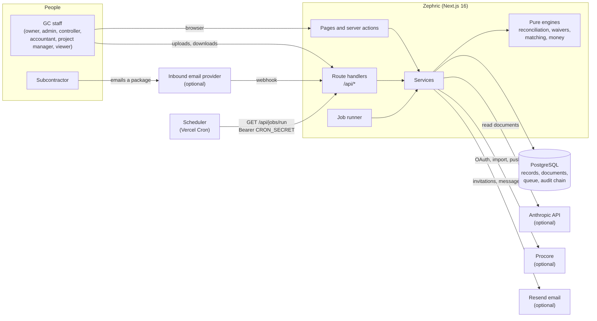
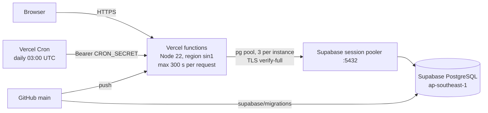
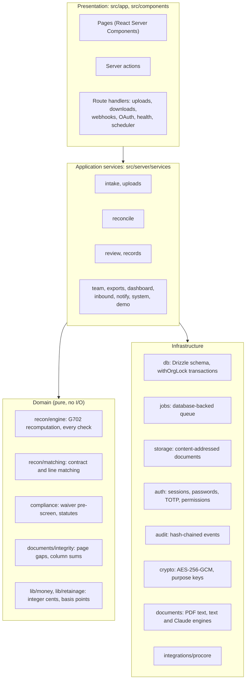
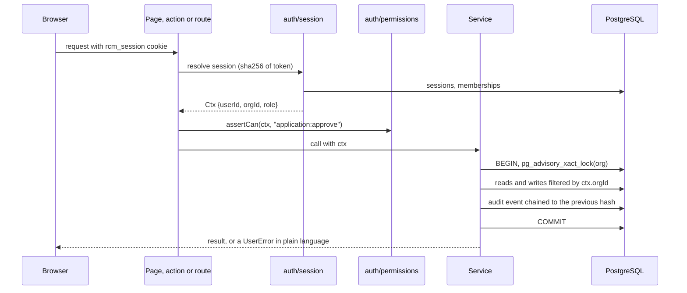
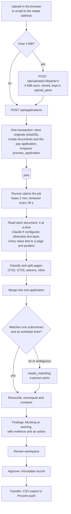
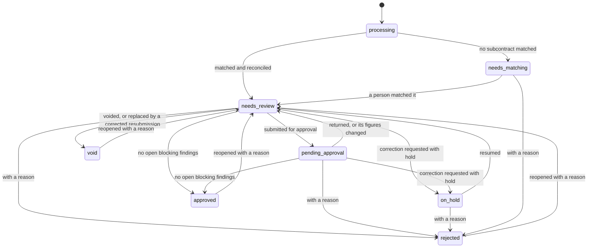
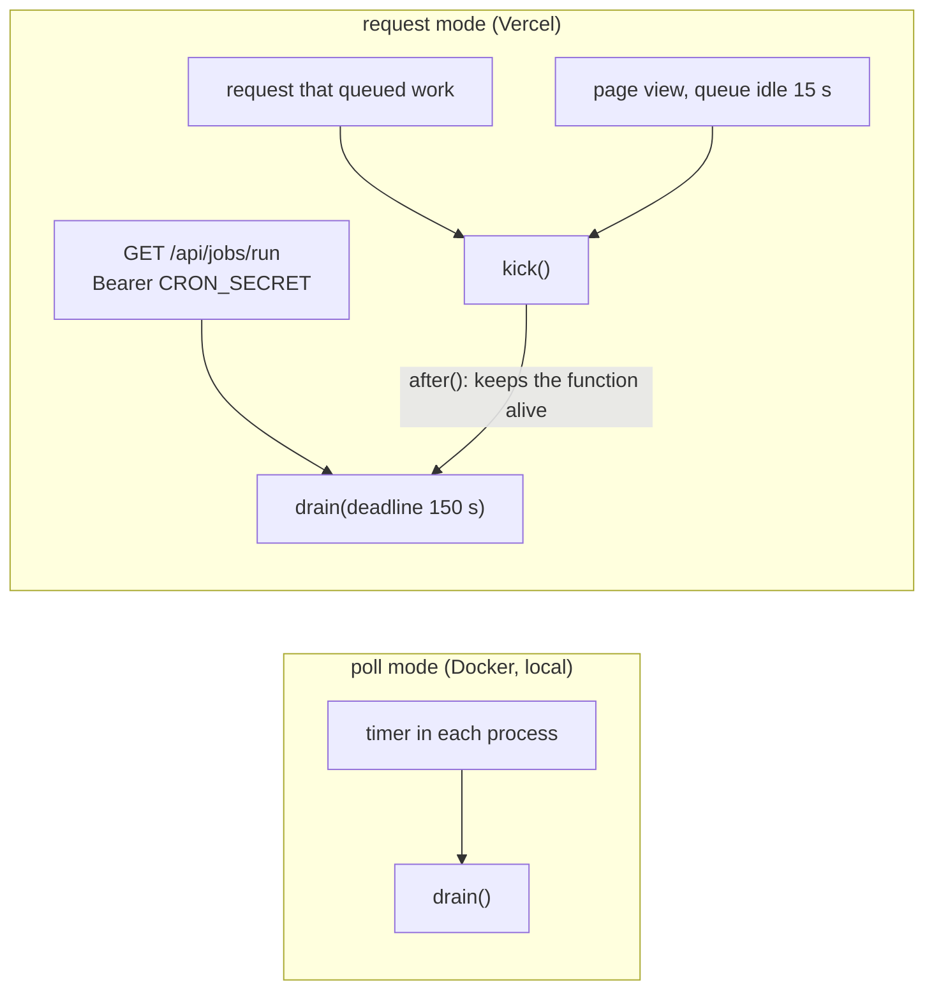
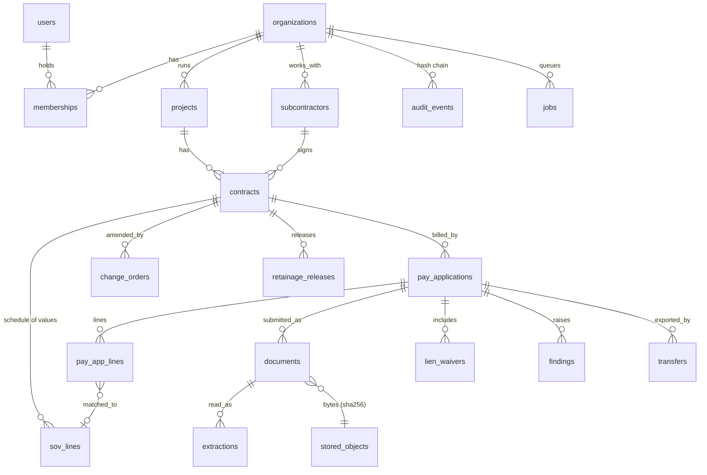

# Zephric

Revenue cycle management for commercial general contractors. A subcontractor's
billing package comes in; the system reads it, works out which subcontract it
belongs to, recomputes every figure from the contract and the approved billing
history, pre-screens the lien waiver, and puts what it found in front of a
reviewer next to the original documents. A controller approves, and the
approved record is exported or pushed to a connected system. Everything along
the way is kept in a tamper-evident audit trail.

It is not an ERP, a payment system or a document store. No money moves from it,
and it does not make legal determinations.

Zephric was called Construction RCM until November 2026. The repository, the
Vercel and Supabase projects and the `construction-rcm.vercel.app` address keep
the old name; everything a customer sees says Zephric. Authenticator entries
made before the rename are labelled "Construction RCM" and keep working.

**Contents:** [Quick start](#quick-start) ·
[What to look at first](#what-to-look-at-first) ·
[Architecture](#architecture) · [Configuration](#configuration) ·
[Deployment](#deployment) · [Testing](#testing) ·
[What is and is not verified](#what-is-and-is-not-verified) ·
[Limitations and risks](#limitations-and-risks) ·
[Repository](#repository) · [Further documentation](#further-documentation)

## Quick start

Requires Node 20.9+ (22 recommended, see `.nvmrc`) and pnpm. Nothing else: no
database server, no API keys.

```bash
pnpm install
```

```bash
pnpm dev
```

Open http://localhost:3000, choose **Set up your company**, then on the
overview page choose **Create the demo workspace**. It builds in a few seconds.

Alternatively, create a sign-in and the demo workspace from the terminal (stop
the dev server first, because the embedded database opens in one process at a
time). The script prints the generated password once:

```bash
pnpm seed:demo
```

Running it for a customer is different: see [Deployment](#deployment) and
[docs/operations.md](docs/operations.md) for hosting, backups, recovery,
monitoring and onboarding the first customer.

## What to look at first

In the demo workspace (fictitious companies; a separate organisation from your
own):

1. **Pay applications** lists what needs attention. Open *Lone Star Electric
   #5*: it re-bills $18,400 that was already certified. Click **Show in
   document** on a finding and the figure is highlighted on the page.
2. *Hill Country Mechanical #4* withholds retainage at 5% against a 10%
   contract. *Pacific Steel Erectors #5* bills a change order that is still
   pending; approve the change order on the contract and the finding clears by
   itself.
3. **Upload package**, download *Gulfstream Plumbing, with three problems*,
   and upload it. Watch it get read, matched and checked. Override the
   findings with a reason (owners, admins and controllers can; project
   accountants cannot), approve, and use **Transfer** to export.
4. **Overview** shows requested against approved by billing period, open
   work, retainage held and turnaround. Every figure is computed from the
   records; none is illustrative.
5. **Activity** is the audit trail, with a check that the chain is intact.

### Try it from an empty organisation

```bash
pnpm samples
```

This writes four PDFs and a schedule of values to `samples/out/` and prints
the subcontract to create for them (project, subcontractor, contract number,
amount, retainage). Create those in the app, paste the schedule into the
schedule editor, upload `1-…`, approve it, then upload `2a-…` or `2b-…` (not
both: they carry the same application number).

## Architecture

### System context



Every external service is optional. Without them the product still works end to
end: the text-layer reader reads digital PDFs, exports are files, and email is
saved as labelled drafts. Nothing reports a call to a service that is not
configured as having succeeded.

### Deployment topologies

The same code runs in three shapes. What changes is where the database lives,
where documents are kept and what drives background work.

| | Local development | Docker / Compose | Vercel + Supabase |
|---|---|---|---|
| Database | PGlite (Postgres compiled to WASM, in-process) under `./.data` | PostgreSQL container | Supabase PostgreSQL via the session pooler, TLS verified against `DATABASE_CA_CERT` |
| Documents | On disk, content-addressed | In PostgreSQL (`stored_objects`) | In PostgreSQL (`stored_objects`) |
| Background work | Polling runner in the server process | Polling runner in each app process | Request mode: runs right after the request that queued it (kept alive with `after()`), on page views when idle, and on a scheduled call to `/api/jobs/run` |
| Uploads | One request | One request | Packages over 4 MB are sent in 4 MiB parts (Vercel's request limit is 4.5 MB) |
| Migrations | Applied by the app | Applied by the app | Applied by Supabase's GitHub integration from `supabase/migrations`; the app only checks the schema (`RCM_MIGRATIONS=external`) |



### Layers



The rules that keep this honest:

- **The domain layer is pure.** Reconciliation, matching, waiver checks and
  money arithmetic take plain data and return plain data. They are tested
  directly and never read the database, the clock or the network.
- **Money is integer cents and rates are basis points** everywhere. Amounts
  read from documents are parsed from text by our code; no total printed on a
  submission and no figure from an AI model is used as the result of a
  calculation.
- **Services own transactions.** Every change to an organisation's records goes
  through `withOrgLock` (`src/db/tx.ts`): one transaction that first takes a
  PostgreSQL advisory lock for that organisation, so a change happens
  completely or not at all and two people's changes apply one after the other.
- **The UI computes nothing that matters.** Pages render what services return;
  decisions are re-checked on the server against the version the user saw.

### Request lifecycle and the tenant boundary



- Every table that holds customer data carries `org_id`, and every query in the
  services filters on the caller's organisation. A user never reaches another
  organisation's records; tests attack this directly (`tests/workflow.test.ts`,
  `tests/team.test.ts`, `tests/auth-hardening.test.ts`).
- State-changing route handlers also check that the request comes from the
  app's own origin (`sameOrigin` in `src/server/http.ts`).
- Organisations that require two-step verification send members without it to
  `/mfa-required` before anything else.

### The billing package pipeline



Failures are visible rather than silent: a job that fails is retried with
backoff, and when every attempt has failed the application is marked with the
error and the person who submitted it is notified. A restart mid-read resumes
the work. A re-read keeps the reviewer's corrections that still apply and says
which ones it dropped.

#### Application lifecycle



Approval also requires every warning to be acknowledged and the version on
screen to be the current one. An approved application cannot be reopened once
it has been pushed to a connected system, or while a later approved application
on the same contract builds on it. A package whose reading failed on every
attempt stays in `processing` with the error shown and the submitter notified.

### Reading documents

`src/server/documents`. Two engines produce the same structure, with a page and
position for every value:

- **Claude** (when `ANTHROPIC_API_KEY` is set). The model transcribes amounts
  as text exactly as printed and is told not to compute or correct. Our code
  turns text into cents, then looks every amount up in the PDF's own text
  layer. A value that is not on the page, or that disagrees with the
  deterministic reader, has its confidence cut and is called out. Reads scans
  and photos.
- **Text-layer reader** (always available, no network). Finds labels and the
  amounts beside them, and reads the schedule of values column by column,
  identifying columns by their headings and cross-checking the column letters
  and row arithmetic. Works on digitally produced PDFs. It declines what it
  cannot read reliably (decimal-comma figures, unlabelled columns, a cover
  letter that mentions a waiver) instead of guessing, cannot read scans, and
  cannot see an ink signature.

Both also report what tells whether everything was read: printed page numbers
("page 2 of 4"), the schedule's printed grand-total row, values printed
differently in two places, and pages with no text layer. Reconciliation turns
those into findings (below).

Extraction accuracy is measured with `pnpm eval:extraction`
([docs/extraction-evaluation.md](docs/extraction-evaluation.md)). The synthetic
corpus is a regression gate run by `pnpm test`; accuracy on real subcontractor
documents has not been measured.

### Reconciliation

`src/server/recon/engine.ts` is a pure function. It computes its own G702 from
the contract, approved change orders, the last approved application and this
period's line items, then compares it with what was submitted. It never relies
on a total printed on the submission. Each check returns a pass or a finding
that says what is wrong, why it matters and what to do, in one of ten
categories: documents, math, contract, change orders, schedule, prior billing,
retainage, payment, compliance and extraction.

Among the checks: arithmetic of every schedule row and of the G702 lines;
previous billing against the last approved application (re-billing is caught);
change orders billed against those approved; retainage against the contract's
terms; schedule rows against the printed grand total, column by column; gaps in
the printed page numbering; pages nobody could read; two different application
numbers in one package; and waiver completeness and consistency. Findings carry
a fingerprint, so an accepted finding reopens by itself if the figures behind it
change.

### Lien waivers

`src/server/compliance`. Classification, completeness (present, signed,
amount, date) and consistency with the application, plus recognition of Texas,
California and Florida statutory form wording. Anything that would be a legal
judgement (non-statutory wording, listed exceptions, an undeterminable type) is
marked "needs qualified review" and can only be signed off by a controller or
admin. The statutory facts were checked against official statute text on
2026-11-15; see `src/server/compliance/jurisdictions.ts`.

### Review and approval

`src/server/services/review.ts`. Blocking findings must be fixed or overridden
with a written reason before approval. Fixing a misread and adjusting what will
be paid are recorded as different things. Approval writes an immutable record;
exports are rendered from that record, never from live data. A decision is made
on what the person saw: approving, rejecting, submitting and overriding carry
the version (and, for approval, the amount) that was on screen, and are refused
if the application has changed since. A corrected resubmission replaces the
earlier one instead of sitting beside it.

**Retainage** (`computeRetainage` in the engine). A flat rate, or a rate that
steps down once the work reaches a percentage of the contract sum (on further
work only, or on all work). Releases are recorded on the contract by an
approver before they are billed, so the application that bills one is checked
against it instead of being flagged for withholding too little.

### Background work

`src/server/jobs.ts`. A queue in the `jobs` table: `queued → running →
succeeded | failed`. A claim is one atomic update, so several app instances can
share a database without running a job twice. A running job holds a lease the
runner renews every 30 seconds; a lease two minutes stale is reclaimed.



`RCM_JOB_RUNNER` forces either mode; by default it is `request` on Vercel and
`poll` elsewhere.

### Data model

All tables live in one PostgreSQL schema defined in `src/db/schema.ts`
(migrations in `drizzle/`, mirrored for Supabase in `supabase/migrations/`).



| Area | Tables |
|---|---|
| Identity and access | `organizations`, `users`, `memberships`, `invitations`, `sessions`, `login_challenges`, `password_resets`, `auth_attempts` |
| Contracts | `projects`, `subcontractors`, `contracts`, `sov_lines`, `change_orders`, `retainage_releases` |
| Billing | `pay_applications`, `pay_app_lines`, `documents`, `extractions`, `lien_waivers`, `findings`, `comments` |
| Outbound and inbound | `communications`, `notifications`, `transfers`, `integrations`, `inbound_messages` |
| Platform | `jobs`, `stored_objects`, `upload_parts`, `audit_events` |

Row-level security is enabled on every table with no policies, and the Supabase
API roles have no grants: the public Data API cannot read or write anything.
Organisations are separated from each other by the application, not by RLS.

### Security model

| Concern | How |
|---|---|
| Sign-in | Passwords (scrypt with a per-password salt, length and common-password rules), optional or organisation-required TOTP two-step verification, single-use recovery codes, remembered browsers. Details in [docs/authentication.md](docs/authentication.md). |
| Sessions | A random token in an HttpOnly, SameSite=Lax cookie (Secure in production); only its SHA-256 is stored. |
| Abuse | A database-backed throttle on sign-in, sign-up and resets that holds across instances. The client address comes from the header the host sets (`RCM_CLIENT_IP_HEADER=x-real-ip` on Vercel). |
| Roles | `owner` and `admin`: everything. `controller`: policy, records, upload, review, approve, compliance sign-off, export. `accountant`: records, upload, review, export. `project_manager`: upload. `viewer`: read only. Checked on the server for every action (`assertCan`). |
| Tenant isolation | Every query scoped by the caller's organisation; tested as an attack. |
| Secrets at rest | Authenticator keys and integration tokens encrypted with AES-256-GCM under a key derived from `RCM_SECRET_KEY`; recovery codes and remembered browsers hashed with per-purpose keys from the same secret. |
| Audit | Append-only events, each committing to the previous event's hash per organisation (`src/server/audit.ts`); Activity checks the chain. |
| Documents | Content-addressed by SHA-256 and verified against the hash on every read. |
| Webhooks and scheduler | The inbound-email webhook needs `INBOUND_EMAIL_SECRET` and a per-organisation token; `/api/jobs/run` needs `CRON_SECRET` (constant-time comparison). Each refuses everything when its secret is not set. |

### Integrations

- **Anthropic** (`src/server/documents/engine-claude.ts`): reads page images
  and returns transcribed text; our code parses and grounds it.
- **Procore** (`src/server/integrations/procore`): OAuth with one token renewal
  at a time across processes, import of projects and subcontracts, push of an
  approved application's contract line items. A push claims the application
  first, lists the subcontract's invoices before creating one, and records a
  lost answer as "no answer" rather than "failed", so sending again cannot make
  a second invoice. Built from the public API documentation
  ([docs/procore-api-notes.md](docs/procore-api-notes.md)).
- **Resend**: invitations and messages to subcontractors. Without a key they
  are saved and labelled "not sent".
- **Inbound email** (`/api/inbound/email/:token`): a provider posts a received
  message; each message is processed once and the sender is checked.

### Observability

`/api/health` (no sign-in, no organisation data) reports the database driver,
latency and TLS state, whether Supabase's Data API exposes anything, the
document storage mode, queue depth and stalled work, the job runner's mode, and
whether this server can open a small test PDF with the reader uploads go through.
It returns 503 with a plain explanation when something is wrong. Settings →
System status shows the same for administrators, plus failed background work and
the email-intake log. Settings → Organisation shows which integrations are
configured on the running deployment.

### Stack

Next.js 16 (App Router) and React 19, TypeScript, Tailwind 4, Drizzle ORM,
node-postgres in production and PGlite in development and tests, pdf.js for
PDF text, pdf-lib for generated samples, zod for input validation, Vitest.
Two versions are pinned for Node 20 compatibility: `pdfjs-dist` 4.x and
`vitest` 3.x.

## Configuration

Copy `.env.example` to `.env.local`. Everything is optional in development.

| Variable | Effect when set | When not set |
|---|---|---|
| `DATABASE_URL` | Uses PostgreSQL | Embedded database under `RCM_DATA_DIR` (`./.data`) |
| `RCM_SECRET_KEY` | Encrypts integration tokens and authenticator keys; keys the hashes of recovery codes and remembered browsers | Required in production; a local key file is generated in development. Treat it as permanent |
| `APP_URL` | Base URL for invite links and OAuth redirects | `http://localhost:3000` |
| `ANTHROPIC_API_KEY` | AI document reading (`RCM_EXTRACTION_MODEL`, default `claude-opus-5-5`) | Text-layer reader only; scans are keyed by hand |
| `PROCORE_CLIENT_ID`, `PROCORE_CLIENT_SECRET`, `PROCORE_ENV` | Procore can be connected | Shown as "Not configured"; file export only |
| `RESEND_API_KEY`, `EMAIL_FROM` | Invitations and messages to subcontractors are emailed | They are saved as drafts and labelled "not sent" |
| `INBOUND_EMAIL_SECRET` | Opens the email-intake webhook | The webhook rejects every request |
| `DATABASE_POOL_MAX` | Connections per process | 10; 3 per instance on Vercel |
| `CRON_SECRET` | Lets the scheduler run the queue at `/api/jobs/run` (needed on Vercel) | That endpoint refuses to run |
| `RCM_JOB_RUNNER` | `poll` or `request` | `request` on Vercel, `poll` elsewhere |
| `DATABASE_CA_CERT` | The database provider's CA (PEM or path): encrypted, verified connection. Needed for Supabase | node-postgres's own TLS rules apply |
| `RCM_MIGRATIONS` | `external`: the app checks the schema that Supabase's GitHub integration applied | The app applies `drizzle/` itself |
| `RCM_CLIENT_IP_HEADER`, `RCM_TRUSTED_PROXY_HOPS` | Where the client address comes from, for the sign-in limits (see `docs/authentication.md`) | The address one proxy appended to `X-Forwarded-For` |
| `RCM_STORAGE` | `database` or `disk` for documents | `database` with `DATABASE_URL`, otherwise `disk` |
| `RCM_EXTRACTION_FALLBACKS` | `off` disables the API's server-side refusal fallback for extraction requests | Fallback on |

## Deployment

The production deployment runs on **Vercel** with the database on **Supabase**.
The full procedure, with Docker as the alternative, is in
[docs/operations.md](docs/operations.md) ("Deploy on Vercel", "Use Supabase as
the database"). In short:

1. **Database.** Supabase's GitHub integration applies `supabase/migrations`
   when they reach `main`. After a schema change run `pnpm db:generate` and
   `pnpm db:supabase`, and commit both.
2. **Vercel project** connected to this repository; framework Next.js; region
   `sin1` (next to the database, `vercel.json`); Node 22 (from
   `package.json` engines). The production branch is `main`: every push to
   `main` deploys production, other branches get protected preview
   deployments.
3. **Environment variables** for Production: `DATABASE_URL` (Supabase session
   pooler), `DATABASE_CA_CERT`, `RCM_SECRET_KEY`, `CRON_SECRET` (all marked
   Sensitive), `APP_URL`, `RCM_MIGRATIONS=external`,
   `RCM_CLIENT_IP_HEADER=x-real-ip`; optionally `ANTHROPIC_API_KEY`,
   `RESEND_API_KEY` and `EMAIL_FROM`. Redeploy after changing them.
4. **Check** `/api/health`: `status: ok`, `database.tls: verified`,
   `dataApi.exposedTables: 0`, `storage: database`, `runner.mode: request`,
   `pdfReader.ok: true`.
5. **Scheduled run**: `vercel.json` registers a daily call to `/api/jobs/run`
   (Hobby plans allow daily schedules only; on Pro it can run every few
   minutes).

## Testing

```bash
pnpm typecheck
```

```bash
pnpm test
```

```bash
pnpm test:pg
```

`pnpm test` runs the suite on PGlite. `pnpm test:pg` downloads and starts a real
PostgreSQL server for the run (removed afterwards) and runs the same suite
through node-postgres. `pnpm eval:extraction` runs the extraction evaluation;
its synthetic gate also runs inside `pnpm test`. `pnpm build` is the production
build Vercel runs.

The suite tests the pure engines directly with hand-computed expectations, runs
the full workflow against a real database, and includes one regression test per
security-review finding written as the attack. External services are never
called: the AI client is stubbed and Procore runs against a local emulator of
its documented API.

## What is and is not verified

Status on 2026-11-16, `main`. The phase as a whole is summarised in
[docs/phase-2-report.md](docs/phase-2-report.md).

**Verified by automated tests.** `pnpm test`: 429 passed, 3 skipped (the
skipped tests need a PostgreSQL server). `pnpm test:pg` on PostgreSQL 18.6:
432 passed. `pnpm typecheck` is clean and `pnpm build` succeeds, on Node 22.
Covered:

- Money parsing and rounding; every reconciliation check, including stepped
  retainage, releases and deductive change orders; waiver pre-screening and
  statutory form recognition.
- What the reading saw besides the figures: schedule rows against the printed
  grand total (integer cents, column by column), gaps in the printed page
  numbering, pages with no text layer, and the same figure or application
  number printed differently in two places. Each blocks until a person looks.
- The synthetic extraction gate: the whole generated corpus through the text
  reader with no confidently wrong value allowed, plus pinned limitations
  (handwritten corrections, European number formats, amounts in words only).
- Reading generated Texas, California and Florida packages from real PDF bytes.
- The full workflow (upload → read → match → reconcile → correct or override →
  approve → export), stale decisions refused, atomic writes that leave nothing
  behind on failure, the job queue under concurrency and restart, role
  enforcement and tenant isolation.
- The audit chain, including detection of an edited event.
- Authentication: TOTP against the RFC test vectors, password reset, two-step
  sign-in and recovery codes, sessions, the database-backed throttle across two
  connection pools, remembered browsers, the organisation's two-step
  requirement, administrator recovery rules, and one regression test per
  security-review finding written as the attack (`tests/auth-hardening.test.ts`).
- Database connections: TLS verification against a real PostgreSQL server
  with a generated CA, and both migration modes.
- Email intake (one processing per message, sender check); exports.
- Serverless hosting: the request-driven queue and its time budget, the
  scheduler endpoint's secret check, and large files sent in parts (joined in
  order, retried parts, missing parts refused, parts invisible to other members
  and organisations, expiry) (`tests/serverless.test.ts`).
- The AI engine's parsing, grounding and failure handling, with a **stubbed**
  client. The Procore client, OAuth renewal and push, including a create
  request whose answer is lost and a retry that finds the invoice instead of
  creating a second one, against a **local emulator** of the documented API.

**Verified by hand in a browser**, on the embedded database: the Phase 1
workflow (sign-up, demo workspace, queue, upload, review with evidence
highlighting, overrides, approval, correction requests, records, transfers,
settings), and on 2026-11-15: turning on two-step verification with codes
computed by an independent implementation, recovery codes shown once, signing
in with a code and with a recovery code, wrong-code counting, password reset
through an operator link (confirmation on the sign-in page, account signed out,
second step still required), "Forgot password?" saying plainly that no email
is set up, system status, accepting an invitation with an account that has
two-step verification (joined only after the code, signed in to the inviting
organisation), an owner refused when recovering a member who belongs to
another organisation, and the password prompt before two-step setup.

**Verified against real infrastructure:**

| What | Result |
|---|---|
| Vercel + Supabase production | https://construction-rcm.vercel.app, Node 22, region sin1, all secrets set. Checked live on 2026-11-15: `/api/health` returns `ok` with PostgreSQL reached through Supabase's session pooler and TLS **verified** against the configured CA, the Data API exposing no table and no table without RLS, documents stored in the database, and the queue empty. `/api/jobs/run` refuses no token and a wrong token (401) and, with `CRON_SECRET`, runs the queue against the live database (200). Signed-out pages redirect to sign-in; the sign-up page renders. |
| Supabase project `construction-rcm` | Schema applied (migrations 0000–0004, recorded under the repository's versions). The Data API, probed from outside with both public keys, refuses every table. |
| Docker image and Compose stack | Built and run to a healthy state on 2026-11-15, before that day's authentication changes; not rebuilt since. |
| Signed-in use of the live site | On 2026-11-15 the owner signed up on the live site, and a project, a subcontractor and a subcontract with a three-line schedule of values ($500,000.00, retainage 10% / 10%) were created through the interface and confirmed in the Supabase database. |
| Uploads and reading on the live site | On 2026-11-15 the five sample PDFs were uploaded as one package, including a 5.9 MB file sent in 4 MiB parts; every stored object matches its original byte for byte (SHA-256). The first reading failed for every file: pdf.js's worker was not in the deployed functions (fixed in [PR #2](https://github.com/arsalannkhann/construction-rcm/pull/2); the health check now opens a test PDF so this shows as `degraded`). After the fix, the four extra files were removed from the package through the interface ([PR #3](https://github.com/arsalannkhann/construction-rcm/pull/3)) and the package was read again: the 4-page file was split into pay application, schedule of values, lien waiver and one unreadable page; it was read as application #1 for the period to 2026-09-30, matched to SC-2301-16, with $99,000.00 requested and verified and $11,000.00 retainage, all equal to the generator's figures. The only open finding was the unreadable page (`doc.unreadable_pages`), with 26 checks passed. Each removal was audited and every background job succeeded on its first attempt. |
| Approval and exports on the live site | On 2026-11-15 the unreadable-page finding was overridden with a written reason (the page is a generated noise image with nothing to key), and application #1 was approved for $99,000.00 with $11,000.00 retainage; the status, amounts and decision time were confirmed in the database, and the override, the approval and each export are in the audit log. The PDF approval record, the CSV of lines and the JSON record were then exported from **Transfer**. Each export's stored bytes match the SHA-256 recorded for it and each downloads, and all three were read back: the PDF (text extracted with pdf.js) shows the nine-line summary with no differences from the submission, the accepted finding with its reason, the three-line schedule of values, the conditional progress waiver for $99,000.00 and the source document's SHA-256, equal to the stored file's; the CSV and JSON carry the same figures. The Procore item is disabled ("Procore is not configured for this deployment"). |

**Not verified, because it needs credentials, documents or infrastructure that
were not available:**

| Area | State |
|---|---|
| Two-step, rejection and the schedule on the live site | Two-step verification and rejecting an application have not been run on the live deployment. The daily scheduled run has not been seen to fire. |
| Claude reading real documents | Never called live (no API key). Accuracy on real pay applications is unmeasured. |
| Real subcontractor documents | None available. The evaluation harness is ready (`pnpm eval:extraction`, `eval/real/README.md`); scores on the synthetic corpus are a regression signal only. How to measure it, the synthetic results and a pilot protocol: [docs/extraction-evaluation.md](docs/extraction-evaluation.md). |
| Procore | Never run against a Procore account. Built from the public documentation (`docs/procore-api-notes.md`) and tested against an emulator of it; the sandbox procedure is [docs/procore-validation.md](docs/procore-validation.md). The duplicate-invoice check assumes Procore lists a new invoice straight away (validation step 12). |
| Outbound email (Resend) | Never sent. |
| Inbound email | The webhook logic is tested; no provider has been pointed at it. |

## Limitations and risks

- **Legal validity is never decided by the software.** Waiver checks are a
  pre-screen; anything uncertain goes to a person.
- **Retainage** supports a flat rate, a reduced rate past a percent-complete
  threshold, and recorded releases. Other contract terms are flagged for a
  person to confirm.
- **No SSO.** Passwords, TOTP two-step verification with recovery codes and an
  organisation-wide requirement are in place; SSO is evaluated in
  `docs/authentication.md` and left until a customer requires it.
- **Accounts are not confirmed by email**, and sign-up says when an address
  already has an account (limited per address).
- **Members of more than one organisation** cannot be recovered by an
  organisation's admins; they reset their own password by email, or the
  operator helps (`pnpm reset-password`).
- **Tenant isolation is enforced in application code**, with tests. Row-level
  security only shuts out Supabase's public API roles; it does not separate
  organisations from each other.
- **No separate worker or object storage.** Background work runs inside the
  app (a polling runner in each long-lived process, or on Vercel right after
  the request that queued it plus a scheduled run), and documents are stored
  in PostgreSQL. Claims are atomic, so several instances can share a database.
- **Vercel's Hobby plan** is for non-commercial use and allows only a daily
  scheduled run. A paying pilot needs a Pro plan.
- **Email intake on Vercel** refuses messages over 4.5 MB, the platform's
  request limit; browser uploads are not limited this way.
- **Procore push** covers contract line items on subcontracts imported from
  Procore. It does not push change-order billing or unit-price contracts, and
  needs an existing Procore billing period. It refuses when the subcontract
  already has an invoice with the application's number, and there is no button
  to link an application to an invoice someone entered in Procore by hand.
- **Payments are not tracked**, so "unconditional waiver for the previous
  payment" is a policy check, not a check against a payment.
- **CSV export is generic**, not an import file for a specific accounting system.
- **Lien waiver knowledge covers three states**, and only form recognition.
  Other states get completeness and consistency checks only.
- Times are shown in the viewer's locale; billing dates are calendar dates
  without a time zone.

## After first customer feedback

1. Run real pay applications from two or three customers through both engines
   and measure reading accuracy field by field. This decides how much of the
   deterministic reader to keep.
2. Connect a Procore sandbox and correct whatever the emulator got wrong.
3. SSO (OIDC, Entra ID first) when a customer makes it a condition of purchase.
4. Final payment applications and billing for retainage releases.
5. A named accounting export (Sage 300 CRE, Vista or CMiC, whichever the first
   customers use) in place of the generic CSV.
6. Subcontractor-facing resubmission, so corrections do not go through email.
7. Postgres row-level security, object storage and a separate worker.

## Repository

```
src/app                  pages, server actions, route handlers
  (auth)/                sign-in, sign-up, invitations, password reset
  (app)/                 overview, applications, contracts, projects,
                         subcontractors, transfers, activity, settings
  api/                   uploads and parts, documents, health, scheduler,
                         inbound email, Procore OAuth, exports
src/components           UI kit, shell, charts, record views
src/lib                  money and retainage arithmetic, upload client, helpers
src/server
  recon/                 reconciliation engine and matching (pure)
  compliance/            lien waiver pre-screen and jurisdiction data (pure)
  documents/             PDF text, the two extraction engines, integrity checks,
                         evaluation scoring
  services/              intake, uploads, reconcile, review, records, team,
                         exports, dashboard, inbound, notify, system, demo
  auth/                  sessions, passwords, TOTP, devices, throttle, permissions
  integrations/procore/  OAuth, client, import, push
  samples/               generates billing PDFs for the demo and the tests
  jobs.ts, audit.ts, crypto.ts, storage.ts, config.ts, http.ts
src/db                   schema, connection, migrations, withOrgLock
drizzle/                 SQL migrations (`pnpm db:generate` after a schema change)
supabase/                the same migrations for Supabase's GitHub integration (`pnpm db:supabase`)
eval/                    extraction evaluation: synthetic gate, truth template, real documents (git-ignored)
scripts/                 seed, reset-password, eval-extraction, samples, migration sync
tests/                   Vitest
docs/                    operations, authentication, conventions, extraction evaluation, Procore notes and validation, Phase 2 report
vercel.json              region and scheduled run for Vercel
```

## Further documentation

| Document | What it covers |
|---|---|
| [docs/operations.md](docs/operations.md) | Deploying (Vercel, Supabase, Docker), backups, recovery, monitoring, onboarding the first customer |
| [docs/authentication.md](docs/authentication.md) | Sign-in design, two-step verification, recovery, throttling, client addresses, the SSO evaluation |
| [docs/extraction-evaluation.md](docs/extraction-evaluation.md) | Measuring reading accuracy, the truth format, the regression gate, synthetic results, the pilot protocol |
| [docs/conventions.md](docs/conventions.md) | Code conventions for contributors |
| [docs/procore-api-notes.md](docs/procore-api-notes.md) | What the Procore integration relies on in Procore's public API |
| [docs/procore-validation.md](docs/procore-validation.md) | The procedure for validating the Procore integration against a developer sandbox |
| [docs/phase-2-report.md](docs/phase-2-report.md) | Phase 2 report: issues found, changes, what is verified, remaining risks, pilot steps |
