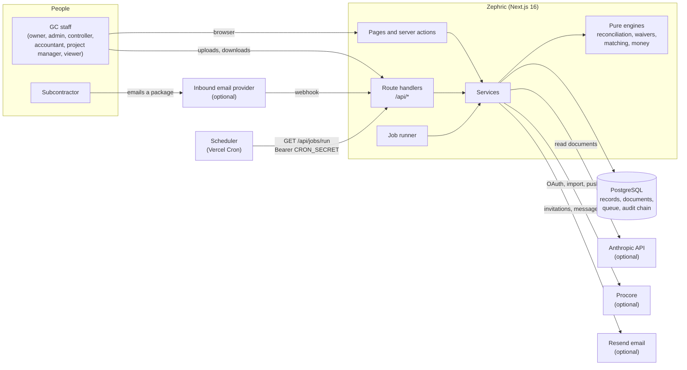
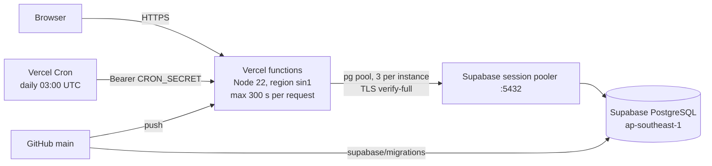
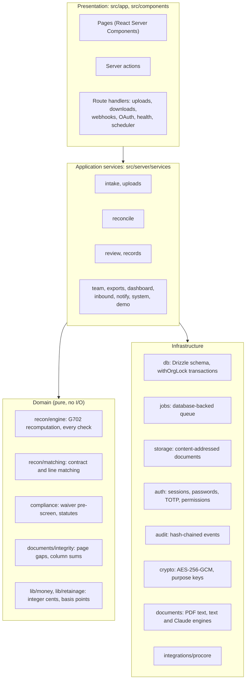
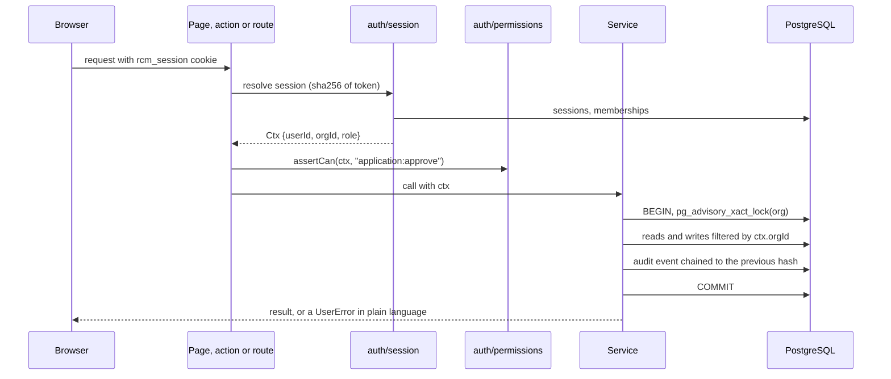
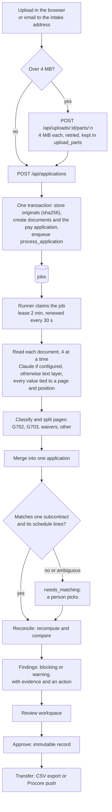
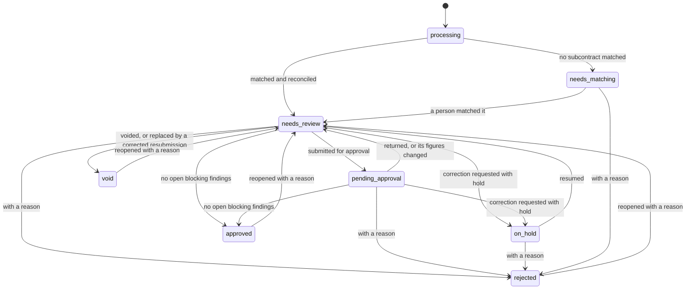
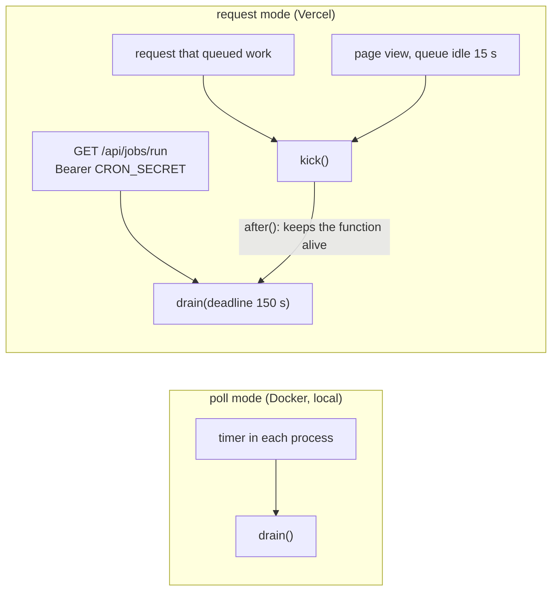
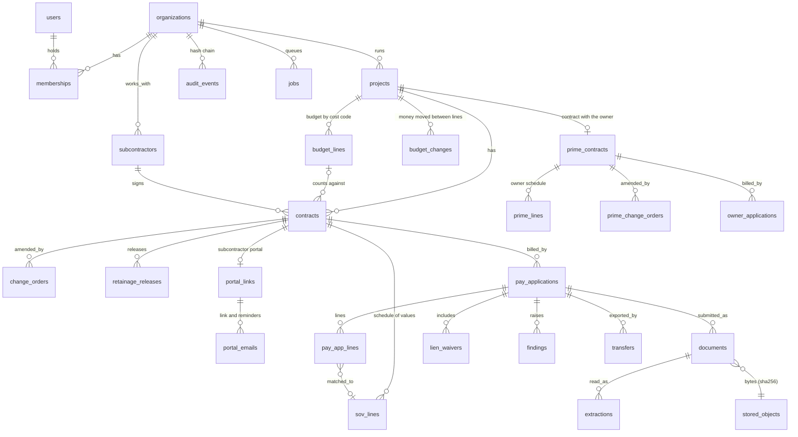

# Zephric

Revenue cycle management for commercial general contractors. A subcontractor's
billing package comes in; the system reads it, works out which subcontract it
belongs to, recomputes every figure from the contract and the approved billing
history, pre-screens the lien waiver, and puts what it found in front of a
reviewer next to the original documents. A controller approves, and the
approved record is exported or pushed to a connected system. Everything along
the way is kept in a tamper-evident audit trail.

It is not an ERP, a payment system or a document store. No money moves from it,
and it does not make legal determinations.

Zephric was called Construction RCM until November 2026. It is served at
https://zephric.vercel.app; `construction-rcm.vercel.app` still serves the same
deployment. The repository and the Vercel and Supabase projects keep the old
name; everything a customer sees says Zephric. Authenticator entries
made before the rename are labelled "Construction RCM" and keep working.

Everyone who opens `/` sees the public Zephric website
(`src/app/(marketing)/`), with a "design partner or demonstration" inquiry form
stored in the `inquiries` table; a signed-in member is offered "Continue to
dashboard" rather than being sent away from the page. `/sample` is a public
sample workflow that needs no account: one fictitious billing package followed
from arrival to decision, built from the product's own output for that
document. See
[operations: the public website](docs/operations.md#the-public-website).

A new member is welcomed once (two questions, then a choice between the
example workspace and setting up their own project), and from then on has a
setup guide worked out from the organisation's records, two product tours and
a Help menu that reopens all of it. See [Onboarding](#onboarding).

A native Android and iOS app (`mobile/`, React Native through Expo) covers the
work away from a desk: photographing or attaching a pay application with
drafts that are kept on the phone until the server confirms receipt, seeing
what is waiting, reading an application's findings and documents, comments
and correction requests, and approving when nothing about the application
needs a desk. It uses the same sessions, permissions and services as the
website through `/api/mobile/*`. See [docs/mobile.md](docs/mobile.md).

**Contents:** [Quick start](#quick-start) ·
[What to look at first](#what-to-look-at-first) ·
[Architecture](#architecture) · [Configuration](#configuration) ·
[Deployment](#deployment) · [Testing](#testing) ·
[What is and is not verified](#what-is-and-is-not-verified) ·
[Limitations and risks](#limitations-and-risks) ·
[Repository](#repository) · [Further documentation](#further-documentation)

## Quick start

Requires Node 20.9+ (22 recommended, see `.nvmrc`) and pnpm. Nothing else: no
database server, no API keys.

```bash
pnpm install
```

```bash
pnpm dev
```

Open http://localhost:3000 and choose **Explore a sample workflow** to see the
public sample without an account. To go further, choose **Sign in → Set up
your company**, and on the welcome step choose **Explore a ready-made
example**: the example workspace (called the demo workspace in the code)
builds in under a minute and opens with a short tour.

Alternatively, create a sign-in and the demo workspace from the terminal (stop
the dev server first, because the embedded database opens in one process at a
time). The script prints the generated password once:

```bash
pnpm seed:demo
```

Running it for a customer is different: see [Deployment](#deployment) and
[docs/operations.md](docs/operations.md) for hosting, backups, recovery,
monitoring and onboarding the first customer.

## What to look at first

In the example workspace (fictitious companies; a separate organisation from
your own). **Help → Tour: how billing is reviewed** walks through the first
two points:

1. **Pay applications** lists what needs attention. Open *Lone Star Electric
   #5*: it re-bills $18,400 that was already certified. Click **Show in
   document** on a finding and the figure is highlighted on the page.
2. *Hill Country Mechanical #4* withholds retainage at 5% against a 10%
   contract. *Pacific Steel Erectors #5* bills a change order that is still
   pending; approve the change order on the contract and the finding clears by
   itself.
3. **Upload package**, download *Gulfstream Plumbing, with three problems*,
   and upload it. Watch it get read, matched and checked. Override the
   findings with a reason (owners, admins and controllers can; project
   accountants cannot), approve, and use **Transfer** to export.
4. **Overview** shows requested against approved by billing period, open
   work, retainage held and turnaround. Every figure is computed from the
   records; none is illustrative.
5. **Riverside Medical Office Building → Owner billing** has the contract with
   the owner and its schedule. Start application #1: it is worked out from the
   subcontractor billing approved so far, laid out as a G702 and G703, with a
   draft PDF. Approve *Capitol Concrete #5* and the draft follows.
6. **Any subcontract → Subcontractor portal**: make a link and open it in a
   private window. That is what the subcontractor sees: their applications,
   what is due, and an upload that arrives already matched.
7. **Riverside Medical Office Building → Budget by cost code** splits the
   project's budget into lines, each with its subcontract, committed, billed to
   date and the forecast cost to complete. The budget is locked; two change
   orders were funded from contingency by budget changes, and HVAC carries an
   entered forecast for work not bought out yet.
8. **Activity** is the audit trail, with a check that the chain is intact.

### Try it from an empty organisation

```bash
pnpm samples
```

This writes four PDFs and a schedule of values to `samples/out/` and prints
the subcontract to create for them (project, subcontractor, contract number,
amount, retainage). Create those in the app, paste the schedule into the
schedule editor, upload `1-…`, approve it, then upload `2a-…` or `2b-…` (not
both: they carry the same application number).

## Architecture

### System context



Every external service is optional. Without them the product still works end to
end: the text-layer reader reads digital PDFs, exports are files, and email is
saved as labelled drafts. Nothing reports a call to a service that is not
configured as having succeeded.

### Deployment topologies

The same code runs in three shapes. What changes is where the database lives,
where documents are kept and what drives background work.

| | Local development | Docker / Compose | Vercel + Supabase |
|---|---|---|---|
| Database | PGlite (Postgres compiled to WASM, in-process) under `./.data` | PostgreSQL container | Supabase PostgreSQL via the session pooler, TLS verified against `DATABASE_CA_CERT` |
| Documents | On disk, content-addressed | In PostgreSQL (`stored_objects`) | In PostgreSQL (`stored_objects`) |
| Background work | Polling runner in the server process | Polling runner in each app process | Request mode: runs right after the request that queued it (kept alive with `after()`), on page views when idle, and on a scheduled call to `/api/jobs/run` |
| Uploads | One request | One request | Packages over 4 MB are sent in 4 MiB parts (Vercel's request limit is 4.5 MB) |
| Migrations | Applied by the app | Applied by the app | Applied by hand from `supabase/migrations` before each merge (the GitHub integration did not apply them); the app only checks the schema (`RCM_MIGRATIONS=external`) |



### Layers



The rules that keep this honest:

- **The domain layer is pure.** Reconciliation, matching, waiver checks and
  money arithmetic take plain data and return plain data. They are tested
  directly and never read the database, the clock or the network.
- **Money is integer cents and rates are basis points** everywhere. Amounts
  read from documents are parsed from text by our code; no total printed on a
  submission and no figure from an AI model is used as the result of a
  calculation.
- **Services own transactions.** Every change to an organisation's records goes
  through `withOrgLock` (`src/db/tx.ts`): one transaction that first takes a
  PostgreSQL advisory lock for that organisation, so a change happens
  completely or not at all and two people's changes apply one after the other.
- **The UI computes nothing that matters.** Pages render what services return;
  decisions are re-checked on the server against the version the user saw.

### Request lifecycle and the tenant boundary



- Every table that holds customer data carries `org_id`, and every query in the
  services filters on the caller's organisation. A user never reaches another
  organisation's records; tests attack this directly (`tests/workflow.test.ts`,
  `tests/team.test.ts`, `tests/auth-hardening.test.ts`).
- State-changing route handlers also check that the request comes from the
  app's own origin (`sameOrigin` in `src/server/http.ts`).
- Organisations that require two-step verification send members without it to
  `/mfa-required` before anything else.

### The billing package pipeline



Failures are visible rather than silent: a job that fails is retried with
backoff, and when every attempt has failed the application is marked with the
error and the person who submitted it is notified. A restart mid-read resumes
the work. A re-read keeps the reviewer's corrections that still apply and says
which ones it dropped.

#### Application lifecycle



Approval also requires every warning to be acknowledged and the version on
screen to be the current one. An approved application cannot be reopened once
it has been pushed to a connected system, or while a later approved application
on the same contract builds on it. A package whose reading failed on every
attempt stays in `processing` with the error shown and the submitter notified.

### Reading documents

`src/server/documents`. Two engines produce the same structure, with a page and
position for every value:

- **Claude** (when `ANTHROPIC_API_KEY` is set; `pnpm ai:key` sets it). The
  model transcribes amounts as text exactly as printed and is told not to
  compute or correct. Our code turns text into cents, then looks every amount
  up in the PDF's own text layer. A value that is not on the page, or that
  disagrees with the deterministic reader, has its confidence cut and is called
  out; a value the model itself was unsure of goes to review. Reads scans and
  photos. A file is read in two structured requests side by side (summary and
  waivers; schedule rows), because the schema for the whole answer is larger
  than the API compiles in one request. Measured on the synthetic corpus in
  [docs/extraction-evaluation.md](docs/extraction-evaluation.md).
- **Text-layer reader** (always available, no network). Finds labels and the
  amounts beside them, and reads the schedule of values column by column,
  identifying columns by their headings and cross-checking the column letters
  and row arithmetic. Works on digitally produced PDFs. It declines what it
  cannot read reliably (decimal-comma figures, unlabelled columns, a cover
  letter that mentions a waiver) instead of guessing, cannot read scans, and
  cannot see an ink signature.

Both also report what tells whether everything was read: printed page numbers
("page 2 of 4"), the schedule's printed grand-total row, values printed
differently in two places, and pages with no text layer. Reconciliation turns
those into findings (below).

Extraction accuracy is measured with `pnpm eval:extraction`
([docs/extraction-evaluation.md](docs/extraction-evaluation.md)). The synthetic
corpus is a regression gate run by `pnpm test`; accuracy on real subcontractor
documents has not been measured.

### Reconciliation

`src/server/recon/engine.ts` is a pure function. It computes its own G702 from
the contract, approved change orders, the last approved application and this
period's line items, then compares it with what was submitted. It never relies
on a total printed on the submission. Each check returns a pass or a finding
that says what is wrong, why it matters and what to do, in one of ten
categories: documents, math, contract, change orders, schedule, prior billing,
retainage, payment, compliance and extraction.

Among the checks: arithmetic of every schedule row and of the G702 lines;
previous billing against the last approved application (re-billing is caught);
change orders billed against those approved; retainage against the contract's
terms; schedule rows against the printed grand total, column by column; gaps in
the printed page numbering; pages nobody could read; two different application
numbers in one package; and waiver completeness and consistency. Findings carry
a fingerprint, so an accepted finding reopens by itself if the figures behind it
change.

### Lien waivers

`src/server/compliance`. Classification, completeness (present, signed,
amount, date) and consistency with the application, plus recognition of Texas,
California and Florida statutory form wording. Anything that would be a legal
judgement (non-statutory wording, listed exceptions, an undeterminable type) is
marked "needs qualified review" and can only be signed off by a controller or
admin. The statutory facts were checked against official statute text on
2026-11-15; see `src/server/compliance/jurisdictions.ts`.

### Review and approval

`src/server/services/review.ts`. Blocking findings must be fixed or overridden
with a written reason before approval. Fixing a misread and adjusting what will
be paid are recorded as different things. Approval writes an immutable record;
exports are rendered from that record, never from live data. A decision is made
on what the person saw: approving, rejecting, submitting and overriding carry
the version (and, for approval, the amount) that was on screen, and are refused
if the application has changed since. A corrected resubmission replaces the
earlier one instead of sitting beside it.

**Retainage** (`computeRetainage` in the engine). A flat rate, or a rate that
steps down once the work reaches a percentage of the contract sum (on further
work only, or on all work). Releases are recorded on the contract by an
approver before they are billed, so the application that bills one is checked
against it instead of being flagged for withholding too little.

### Cost control and billing periods

`src/server/services/cost.ts` and `src/server/services/billing.ts`, computed
from records on every request. The one forecast is what is still to be
committed on each budget line (below), by a method chosen for that line.

- **Budget and commitments.** A project can carry a budget for its
  subcontracted work: one figure, or lines by cost code (see
  [Budget by cost code](#budget-by-cost-code)). The project page sets it against what is committed
  (subcontracts plus approved change orders), the change orders still pending,
  and the projected cost (committed plus pending), and says what is left or by
  how much it is over. Projects and the overview show the standing.
- **Billing periods** (`/billing`, and a six-month grid on each project). A
  period is the calendar month of an application's "period to" date. A
  subcontract is expected to bill once it has started billing, while it is
  active and not fully billed. In a month that has ended, an expected
  subcontract with no application is *missing*; in the current month it is
  *not received yet*.
- **Approved billing roll-up.** Per project and period, a CSV of the approved
  subcontractor figures from the immutable approved records (work this period,
  stored materials, retainage, payment due): the basis of the owner's invoice.
  Needs the export permission; each download is in the audit trail.
- **Cost and billing risks** on the overview: projects over or within 5% of
  budget, budget lines projected over their own budget, subcontracts on no
  budget line, a forecast over budget when the project is not already over,
  pending change orders of 10% or more of a subcontract, and subcontracts that
  missed the last closed period. Each is a rule with its
  numbers and a link, not a model's judgement.

How this compares with Procore's cost management, and what to build next:
[docs/competitive/procore-cost-management.md](docs/competitive/procore-cost-management.md).

### Budget by cost code

A project's budget for subcontracted work, split into lines by cost code
(`src/server/services/budget-calc.ts` for the arithmetic, `budget.ts` for the
workflow; the page is `/projects/[id]/budget`).

- **Lines.** Each line has a cost code, a description and an original budget.
  Codes used on the organisation's other projects and common trade codes are
  suggested. The first lines take over a project's single budget figure:
  whatever they do not use goes to a *99 00 00 Contingency* line, so the total
  stays the same, and from then on the project's budget is the total of its
  lines. *Start from the subcontracts* makes one line per trade from the
  subcontracts already on the project, each at what is committed on it, with
  the rest of the single budget in contingency; if that budget is less than
  what is committed, the lines share it in proportion, to the cent.
- **Each subcontract counts against at most one line.** Per line: the budget
  (original, plus budget changes in, less changes out), committed
  (subcontracts plus approved change orders), pending change orders and billed
  to date (completed and stored on the latest approved application). Any
  subcontract on no line is a row of its own, so the lines and that row add up
  to the project's figures. When assigning, each subcontract is offered the
  line that matches its trade.
- **Budget changes** move money between lines, or add to or take from the
  budget, each with a reason. No change may leave a line below zero; a change
  is voided, never deleted, and voiding is checked the same way.
- **Locking** freezes the original budgets: new lines start at $0 and a line
  with an original budget cannot be removed, so money then moves only by budget
  changes. Members who keep the records lock it; unlocking takes an owner,
  admin or controller. A line with budget changes on record is never removed.
- **The forecast.** What is still to be committed on a line is the only
  forecast, by a method chosen per line: *the rest of the budget* (the
  default: whatever the line's budget does not yet cover), *an amount we
  enter*, with a note, or *nothing more*. The estimate at completion is
  committed plus pending plus still to commit; the cost to complete is that
  less billed to date; over or under is the budget less the estimate. The page
  keeps the figures from records and the forecast in separate column groups.
- **CSV** of every line and the total, needing the export permission; each
  download is in the audit trail, as is every change to the budget.
- **Elsewhere**: the project page shows the forecast and links to the budget,
  the project's edit form shows the lines' total instead of a budget field,
  each subcontract page names its line, and the overview lists the line risks
  above.

### Owner billing

The main contractor's own application for payment to the owner, laid out as a
G702 summary and a G703 continuation sheet (`src/server/services/owner-calc.ts`
for the arithmetic, `owner-billing.ts` for the workflow, `owner-billing-pdf.ts`
for the PDF; pages under `/projects/[id]/owner-billing`).

- **The contract with the owner** carries its sum, retainage on work and on
  stored materials, and owner change orders. An approved owner change order
  adds a line of its own to the owner schedule.
- **Each schedule line says how it is billed.** *Follows subcontracts*: the
  line's value times the approved percent complete of the subcontracts linked
  to it (work and stored materials separately, weighted by contract sum, exact
  integer arithmetic rounded half away from zero), so a line priced above the
  subcontract bills in step with it. *Follows the rest of the contract*: fee,
  insurance and bonds, at the percent complete of the other lines. *Entered
  each period*: general conditions and self-performed work.
- **Only approved billing counts.** For each subcontract a draft uses the
  latest application approved with a period ending in or before the owner
  application's month, read from its immutable approved record. A draft is
  worked out again every time it is opened; people can type over columns E and
  F on any line, with a note, and the worked-out figure stays alongside.
- **Checks** before submitting: the schedule must add up to the contract sum
  and no line may be billed beyond its value (both block submission); lines
  typed above the approved progress, subcontracts not on the schedule and
  subcontractor applications for the period still in review are warnings.
- **Submitting** (owners, admins, controllers) freezes the figures into a
  record with a fingerprint; the submit is refused if the figures changed since
  the approver looked. The owner's certification is recorded, with a reason
  when it is short of the amount applied for, and the certified amounts are the
  previous certificates on the next application. Only the latest submitted
  application can be reopened, with a reason; a certified one cannot.
- **PDF**: summary page and landscape continuation sheets, marked DRAFT until
  submitted, stamped with the record's id and fingerprint. Needs the export
  permission; each download is in the audit trail. Nothing is emailed: the
  team sends the PDF to the owner.
- **Overview risk**: approved subcontractor billing for a month that no
  submitted application to the owner covers yet.

### Subcontractor portal

A link per subcontract that the subcontractor uses, without an account, to send
billing and see what happened to it (`src/server/services/portal.ts`; the page
is `/portal/[token]`, managed from the subcontract page).

- **What the link can do.** Upload a package (PDFs and photos, large files in
  parts as for members), which arrives exactly like an upload, already matched
  to the subcontract and marked as received through the portal. And see every
  application on that subcontract: received, in review, waiting on them with
  the messages the team sent them, approved with the approved amount, or
  rejected. Nothing else: no findings, comments, decision notes, other
  subcontracts or anything about the main contractor's other work.
- **The token** is 256 random bits. Requests are looked up by its SHA-256; the
  token itself is stored encrypted with `RCM_SECRET_KEY` so the team can copy
  the link again and reminders can carry it. Every join from the link is held
  to the link's organisation. One live link per subcontract (a partial unique
  index); replacing or turning it off stops the old one at once. Failed lookups
  are counted per network address (20 in 15 minutes), packages per subcontract
  per day are limited (10), and the page is `noindex` with no referrer.
- **Who manages it.** Members who review applications make, copy, email,
  replace and turn off links; others see only that a link exists.
- **Reminders.** The daily scheduled run emails each live link whose
  subcontract is *due* this month on the billing board (it has started billing,
  is active, is not fully billed, and nothing has arrived for the month; a
  package still being read counts as arrived) once in the five days before the
  organisation's due day (Settings → Policy, default the 25th) and once after
  it. One reminder of each kind per subcontract and month, enforced by a unique
  index; a failed send is recorded as failed, its creator is told, and it is not
  retried. With no email provider configured nothing is sent and the
  subcontract page says so.

### Onboarding

Three things, kept apart on purpose (`src/server/services/onboarding.ts`):

- **The welcome step** (`/start`). A membership with no onboarding record is
  new: its member is sent to `/start` once, from the app layout. It asks what
  they will mostly do (their *focus*, offered only where their role can do the
  work), and, of someone who manages the organisation, the company type and
  where its projects are. The focus orders the overview and its "Needs you"
  list (`src/lib/next-actions.ts`); the company profile
  (`organizations.settings.profile`) only changes guidance. Neither grants or
  removes any permission. Migration 0011 gave every existing membership an
  empty record, so nobody who was already a member is interrupted.
- **The setup guide** (`/get-started`, `src/lib/setup-guide.ts`). Eight steps
  from an empty organisation to a first decided application. No step is ticked
  by hand: each is done when the record exists, whoever made it, so the guide
  can be left and resumed by anyone on the team. The one exception, "see what
  was read", is noted per member the first time they open an application. A
  step the member's role cannot do says who can.
- **Tours** (`src/components/tour/`). A step names a control by its
  `data-tour` attribute and is only ever shown against a control that is on
  screen; optional steps are passed over where the control is absent (a narrow
  screen, a role without it). The tour shields the page while a step is
  showing and never operates a control: steps that are the member's to do wait
  for their own click, so nothing is approved, sent or deleted by a tour.
  Progress is saved on the membership (`memberships.onboarding`), so a tour
  survives a reload or signing in again; closing it pauses it, and Help
  restarts either tour at any time.

The **public sample** (`/sample`) is a static page. Its content is
`src/content/sample-workflow.json`, written by `pnpm sample:build`: the script
creates a throwaway in-memory database, runs one fictitious subcontract
through the real intake, reading, reconciliation and approval code
(`src/server/services/sample-workflow.ts`), and saves what the review
workspace would show for the last, undecided application, with the PDF under
`public/sample/`. `tests/sample-workflow.test.ts` rebuilds it and fails when
the saved copy no longer matches, so the page and the homepage's preview
cannot show a result the product would not produce. What a visitor does on the
page (writing a reason, approving) happens in their browser tab only.

### Background work

`src/server/jobs.ts`. A queue in the `jobs` table: `queued → running →
succeeded | failed`. A claim is one atomic update, so several app instances can
share a database without running a job twice. A running job holds a lease the
runner renews every 30 seconds; a lease two minutes stale is reclaimed.



`RCM_JOB_RUNNER` forces either mode; by default it is `request` on Vercel and
`poll` elsewhere.

### Data model

All tables live in one PostgreSQL schema defined in `src/db/schema.ts`
(migrations in `drizzle/`, mirrored for Supabase in `supabase/migrations/`).



| Area | Tables |
|---|---|
| Identity and access | `organizations`, `users`, `memberships`, `invitations`, `sessions`, `login_challenges`, `password_resets`, `auth_attempts` |
| Contracts | `projects`, `subcontractors`, `contracts`, `sov_lines`, `change_orders`, `retainage_releases` |
| Budget | `budget_lines`, `budget_changes` |
| Billing | `pay_applications`, `pay_app_lines`, `documents`, `extractions`, `lien_waivers`, `findings`, `comments` |
| Owner billing | `prime_contracts`, `prime_lines`, `prime_change_orders`, `owner_applications` |
| Subcontractor portal | `portal_links`, `portal_emails`, `portal_upload_parts` |
| Outbound and inbound | `communications`, `notifications`, `transfers`, `integrations`, `inbound_messages` |
| Platform | `jobs`, `stored_objects`, `upload_parts`, `audit_events` |

Row-level security is enabled on every table with no policies, and the Supabase
API roles have no grants: the public Data API cannot read or write anything.
Organisations are separated from each other by the application, not by RLS.

### Security model

| Concern | How |
|---|---|
| Sign-in | Passwords (scrypt with a per-password salt, length and common-password rules), optional or organisation-required TOTP two-step verification, single-use recovery codes, remembered browsers. Details in [docs/authentication.md](docs/authentication.md). |
| Sessions | A random token in an HttpOnly, SameSite=Lax cookie (Secure in production); only its SHA-256 is stored. |
| Abuse | A database-backed throttle on sign-in, sign-up and resets that holds across instances. The client address comes from the header the host sets (`RCM_CLIENT_IP_HEADER=x-real-ip` on Vercel). |
| Roles | `owner` and `admin`: everything. `controller`: policy, records, upload, review, approve, compliance sign-off, export. `accountant`: records, upload, review, export. `project_manager`: upload. `viewer`: read only. Checked on the server for every action (`assertCan`). |
| Tenant isolation | Every query scoped by the caller's organisation; tested as an attack. |
| Secrets at rest | Authenticator keys and integration tokens encrypted with AES-256-GCM under a key derived from `RCM_SECRET_KEY`; recovery codes and remembered browsers hashed with per-purpose keys from the same secret. |
| Audit | Append-only events, each committing to the previous event's hash per organisation (`src/server/audit.ts`); Activity checks the chain. |
| Documents | Content-addressed by SHA-256 and verified against the hash on every read. |
| Subcontractor portal | A link reaches one subcontract of one organisation and only what was meant for the subcontractor; only the token's SHA-256 is looked up, the token is encrypted at rest, failed lookups are throttled per address, and a replaced or turned-off link stops at once. Tested as an attack (`tests/portal.test.ts`). |
| Webhooks and scheduler | The inbound-email webhook needs `INBOUND_EMAIL_SECRET` and a per-organisation token; `/api/jobs/run` needs `CRON_SECRET` (constant-time comparison). Each refuses everything when its secret is not set. |

### Integrations

- **Anthropic** (`src/server/documents/engine-claude.ts`): reads page images
  and returns transcribed text; our code parses and grounds it.
- **Procore** (`src/server/integrations/procore`): OAuth with one token renewal
  at a time across processes, import of projects and subcontracts, push of an
  approved application's contract line items. A push claims the application
  first, lists the subcontract's invoices before creating one, and records a
  lost answer as "no answer" rather than "failed", so sending again cannot make
  a second invoice. Built from the public API documentation
  ([docs/procore-api-notes.md](docs/procore-api-notes.md)).
- **Resend**: invitations, reset links and messages to subcontractors. Each
  message carries an idempotency key, so one retry after a lost answer cannot
  send it twice; a message the provider never answered for is recorded as "not
  confirmed", not "failed", and is not sent again automatically. Without a key
  they are saved and labelled "not sent".
- **Inbound email** (`/api/inbound/email/:token`): a provider posts a received
  message; each message is processed once and the sender is checked. The
  secret is checked before the body is read; messages marked as spam or failing
  SPF are turned away. What was checked against Postmark's and Resend's
  documentation, and what is still unverified:
  [docs/email-provider-notes.md](docs/email-provider-notes.md).

### Observability

`/api/health` (no sign-in, no organisation data) reports the database driver,
latency and TLS state, whether Supabase's Data API exposes anything, the
document storage mode, queue depth and stalled work, the job runner's mode, and
whether this server can open a small test PDF with the reader uploads go through.
It returns 503 with a plain explanation when something is wrong. Settings →
System status shows the same for administrators, plus failed background work and
the email-intake log. Settings → Organisation shows which integrations are
configured on the running deployment.

### Stack

Next.js 16 (App Router) and React 19, TypeScript, Tailwind 4, Drizzle ORM,
node-postgres in production and PGlite in development and tests, pdf.js for
PDF text, pdf-lib for generated samples, zod for input validation, Vitest.
Two versions are pinned for Node 20 compatibility: `pdfjs-dist` 4.x and
`vitest` 3.x.

## Configuration

Copy `.env.example` to `.env.local`. Everything is optional in development.

| Variable | Effect when set | When not set |
|---|---|---|
| `DATABASE_URL` | Uses PostgreSQL | Embedded database under `RCM_DATA_DIR` (`./.data`) |
| `RCM_SECRET_KEY` | Encrypts integration tokens and authenticator keys; keys the hashes of recovery codes and remembered browsers | Required in production; a local key file is generated in development. Treat it as permanent |
| `APP_URL` | Base URL for invite links and OAuth redirects | `http://localhost:3000` |
| `ANTHROPIC_API_KEY` | AI document reading (`RCM_EXTRACTION_MODEL`, default `claude-opus-5-5`) | Text-layer reader only; scans are keyed by hand |
| `PROCORE_CLIENT_ID`, `PROCORE_CLIENT_SECRET`, `PROCORE_ENV` | Procore can be connected | Shown as "Not configured"; file export only |
| `RESEND_API_KEY`, `EMAIL_FROM` | Invitations and messages to subcontractors are emailed | They are saved as drafts and labelled "not sent" |
| `INBOUND_EMAIL_SECRET` | Opens the email-intake webhook | The webhook rejects every request |
| `DATABASE_POOL_MAX` | Connections per process | 10; 3 per instance on Vercel |
| `CRON_SECRET` | Lets the scheduler run the queue at `/api/jobs/run` (needed on Vercel) | That endpoint refuses to run |
| `RCM_JOB_RUNNER` | `poll` or `request` | `request` on Vercel, `poll` elsewhere |
| `DATABASE_CA_CERT` | The database provider's CA (PEM or path): encrypted, verified connection. Needed for Supabase | node-postgres's own TLS rules apply |
| `RCM_MIGRATIONS` | `external`: the app only checks the schema, applied outside it (on Supabase, from `supabase/migrations`) | The app applies `drizzle/` itself |
| `RCM_CLIENT_IP_HEADER`, `RCM_TRUSTED_PROXY_HOPS` | Where the client address comes from, for the sign-in limits (see `docs/authentication.md`) | The address one proxy appended to `X-Forwarded-For` |
| `RCM_STORAGE` | `database` or `disk` for documents | `database` with `DATABASE_URL`, otherwise `disk` |
| `RCM_EXTRACTION_FALLBACKS` | `off` disables the API's server-side refusal fallback for extraction requests | Fallback on |
| `RCM_EXTRACTION_TIMEOUT_SECONDS` | Longest one AI read of a document may take | 240 seconds, and never past the job's time limit on serverless hosting |

## Deployment

The production deployment runs on **Vercel** with the database on **Supabase**.
The full procedure, with Docker as the alternative, is in
[docs/operations.md](docs/operations.md) ("Deploy on Vercel", "Use Supabase as
the database"). In short:

1. **Database.** After a schema change run `pnpm db:generate` and
   `pnpm db:supabase`, and commit both. Apply the new file to Supabase by hand
   **before merging** (operations, "Schema"): the GitHub integration did not
   apply migration 0005 on its own, and production refused to start until it
   was applied.
2. **Vercel project** connected to this repository; framework Next.js; region
   `sin1` (next to the database, `vercel.json`); Node 22 (from
   `package.json` engines). The production branch is `main`: every push to
   `main` deploys production, other branches get protected preview
   deployments.
3. **Environment variables** for Production: `DATABASE_URL` (Supabase session
   pooler), `DATABASE_CA_CERT`, `RCM_SECRET_KEY`, `CRON_SECRET` (all marked
   Sensitive), `APP_URL`, `RCM_MIGRATIONS=external`,
   `RCM_CLIENT_IP_HEADER=x-real-ip`; optionally `ANTHROPIC_API_KEY`,
   `RESEND_API_KEY` and `EMAIL_FROM`. Redeploy after changing them.
4. **Check** `/api/health`: `status: ok`, `database.tls: verified`,
   `dataApi.exposedTables: 0`, `storage: database`, `runner.mode: request`,
   `pdfReader.ok: true`.
5. **Scheduled run**: `vercel.json` registers a daily call to `/api/jobs/run`
   (Hobby plans allow daily schedules only; on Pro it can run every few
   minutes).

## Testing

```bash
pnpm typecheck
```

```bash
pnpm test
```

```bash
pnpm test:pg
```

For the mobile app:

```bash
cd mobile && npm ci && npx tsc --noEmit
```

`pnpm test` runs the suite on PGlite. `pnpm test:pg` downloads and starts a real
PostgreSQL server for the run (removed afterwards) and runs the same suite
through node-postgres. `pnpm eval:extraction` runs the extraction evaluation;
its synthetic gate also runs inside `pnpm test`. `pnpm build` is the production
build Vercel runs.

The suite tests the pure engines directly with hand-computed expectations, runs
the full workflow against a real database, and includes one regression test per
security-review finding written as the attack. External services are never
called: the AI client is stubbed and Procore runs against a local emulator of
its documented API.

## What is and is not verified

Status on 2026-11-18, `main`. The current phase is summarised in
[docs/phase-3-report.md](docs/phase-3-report.md), the previous one in
[docs/phase-2-report.md](docs/phase-2-report.md).

**Verified by automated tests.** `pnpm test`: 598 passed, 3 skipped (the
skipped tests need a PostgreSQL server; counted on 2026-11-22 as 585 in a
checkout without `mobile/node_modules`, where the 13 phone-formatting tests
cannot load, plus those 13). `pnpm test:pg` on a throwaway
PostgreSQL server: 496 passed (run before cost control, billing periods,
owner billing, the subcontractor portal and budgets by cost code were added;
not re-run since). `pnpm typecheck` is clean and `pnpm build`
succeeds, on Node 22; `npx tsc --noEmit` in `mobile/` is clean. Covered:

- Money parsing and rounding; every reconciliation check, including stepped
  retainage, releases and deductive change orders; waiver pre-screening and
  statutory form recognition.
- What the reading saw besides the figures: schedule rows against the printed
  grand total (integer cents, column by column), gaps in the printed page
  numbering, pages with no text layer, and the same figure or application
  number printed differently in two places. Each blocks until a person looks.
- The synthetic extraction gate: the whole generated corpus through the text
  reader with no confidently wrong value allowed, plus pinned limitations
  (handwritten corrections, European number formats, amounts in words only).
- Reading generated Texas, California and Florida packages from real PDF bytes.
- The full workflow (upload → read → match → reconcile → correct or override →
  approve → export), stale decisions refused, atomic writes that leave nothing
  behind on failure, the job queue under concurrency and restart, role
  enforcement and tenant isolation.
- The audit chain, including detection of an edited event.
- Cost control and billing periods (`tests/cost-billing.test.ts`): budget
  standing with pending change orders and deducts; which subcontracts are
  expected, missing, due, fully billed or closed in each period, including
  resubmissions, void and undated applications and closed projects; the
  roll-up CSV built from approved records, its permission check and audit
  entry; organisation isolation of the board and the roll-up; and the risks
  the overview lists.
- Owner billing (`tests/owner-billing.test.ts`): the scaling arithmetic
  (exact for large amounts, half away from zero), pass-through, marked-up,
  fee and hand-entered lines, figures typed over, the G702 lines and the
  checks, by hand-computed expectations; then end to end: who may set up,
  edit, submit, certify and download, organisation isolation of every read and
  write, schedule links limited to the project's subcontracts, a draft from
  approved September billing, edits refused on stale figures, submission
  refused on figures that changed, frozen figures after a later approval,
  a short certification needing a reason, the next application building on
  the certified amount, reopen and delete rules, billed lines and change
  orders protected, the PDF's pages and filenames, every action audited, and
  the overview risk. The demo test checks that the demo's owner contract
  produces a draft with nothing blocking.
- The subcontractor portal (`tests/portal.test.ts`), written as attacks where
  it matters: only reviewers make links; a link opens exactly its subcontract
  and stops the moment it is replaced or turned off; malformed tokens, other
  organisations and other subcontracts reach nothing; neither stored column
  holds the token; the view shows the messages sent to the subcontractor and
  the approved amount but no comment, finding or decision note; uploads
  arrive matched, readable files only, within the daily limit, refused on a
  closed subcontract or a link turned off mid-way; parts joined per link and
  invisible to other links; the API route with the link as its only
  credential, cross-site posts refused, and wrong links counted per address
  until even a right one is refused from there. Reminders: once before the due
  day and once after, with the link, never twice; none when the month's
  billing is in, still being read, reminders are off, there is no address or
  the subcontract has not started billing; the organisation's due day; nothing
  attempted without an email provider; a failed send recorded, its creator
  told, and not retried.
- Budgets by cost code (`tests/budget.test.ts`): the line arithmetic and each
  forecast method by hand-computed expectations, void changes ignored, the
  unassigned row making the lines add up; who may change, lock, unlock and
  download, and organisation isolation of every read and write (a line,
  change or subcontract from another organisation is not found); the single
  budget taken over with contingency for the rest; a duplicate cost code
  refused; assignment limited to the project's subcontracts; budget changes
  that would take a line below zero refused, including by voiding; the lock
  (new lines at $0, original budgets and their lines kept) and unlock; lines
  with budget changes kept; the project page, projects list and overview
  using the lines; the overview's line, unassigned and forecast risks; the
  CSV; starting from the subcontracts, including a budget below what is
  committed shared in proportion; and every change audited.
- Onboarding (`tests/onboarding.test.ts`): the welcome step shown once to a
  new membership and never to an existing one or in the example workspace;
  focuses limited to what a role can do; the company profile taken only from
  someone who manages the organisation, audited, and kept when review policy
  changes; the setup guide following an organisation's records from empty to
  a decided application, per role, with organisation isolation; tour progress,
  pausing and finishing per member; and the overview's "Needs you" list never
  offering a role work it cannot do. The public sample
  (`tests/sample-workflow.test.ts`): the saved snapshot equals what the
  product produces for the sample package today, and its PDF and highlight
  positions are consistent.
- The mobile API (`tests/mobile.test.ts`): bearer sign-in and sign-out (the
  token is never read from a query string), the second step, organisation
  isolation, refusal of a member who owes their organisation two-step
  verification, capture with duplicate protection by client reference, photos
  combined into one PDF, role checks, and phone approval only for a clean
  pending application with the amount the phone showed (stale amounts
  refused, anything else sent to the desktop). Phone money formatting
  (`tests/mobile-format.test.ts`, in three time zones), and which files
  shared into the app from another app are taken and what the person is
  told about the rest (`tests/mobile-shared.test.ts`).
- Authentication: TOTP against the RFC test vectors, password reset, two-step
  sign-in and recovery codes, sessions, the database-backed throttle across two
  connection pools, remembered browsers, the organisation's two-step
  requirement, administrator recovery rules, and one regression test per
  security-review finding written as the attack (`tests/auth-hardening.test.ts`).
- Database connections: TLS verification against a real PostgreSQL server
  with a generated CA, and both migration modes.
- Email intake (one processing per message, sender check, the secret checked
  before the body is read, spam and SPF failures turned away); outbound email
  against a stub of Resend's documented API (idempotency key, one safe retry,
  "not confirmed" when no answer comes); exports.
- AI reading under time limits (a hanging call stopped by the per-read and the
  job's limit, fallback to the text reader), the backup-reader warning, Read
  again, and the reviewer-correction counts.
- Setting up a schedule of values from a spreadsheet (total and subtotal rows
  left out and checked) and a subcontract from a package that could not be
  matched.
- Serverless hosting: the request-driven queue and its time budget, the
  scheduler endpoint's secret check, and large files sent in parts (joined in
  order, retried parts, missing parts refused, parts invisible to other members
  and organisations, expiry) (`tests/serverless.test.ts`).
- The AI engine's parsing, grounding and failure handling, with a **stubbed**
  client; `pnpm ai:key`'s key checks, `.env` editing and argument handling
  (`tests/ai-key.test.ts`). The Procore client, OAuth renewal and push, including a create
  request whose answer is lost and a retry that finds the invoice instead of
  creating a second one, against a **local emulator** of the documented API.

**Verified by hand in a browser**, on the embedded database: the Phase 1
workflow (sign-up, demo workspace, queue, upload, review with evidence
highlighting, overrides, approval, correction requests, records, transfers,
settings), and on 2026-11-15: turning on two-step verification with codes
computed by an independent implementation, recovery codes shown once, signing
in with a code and with a recovery code, wrong-code counting, password reset
through an operator link (confirmation on the sign-in page, account signed out,
second step still required), "Forgot password?" saying plainly that no email
is set up, system status, accepting an invitation with an account that has
two-step verification (joined only after the code, signed in to the inviting
organisation), an owner refused when recovering a member who belongs to
another organisation, and the password prompt before two-step setup. On 2026-11-17,
on a local server with a scratch database, owner billing on the demo
workspace: the overview risk for September, starting application #1 for
September (every figure equal to an independent calculation from the demo's
percentages), typing over general conditions and seeing the fee follow,
submitting, the PDF (two pages, read back as images), a short certification
with its reason, application #2 carrying the certified amount as the previous
certificate and following a subcontractor approval made meanwhile, the
overview risk moving to October, and the pages at 375 px. On 2026-11-18, the
subcontractor portal on the same setup: making a link on a subcontract, opening
it in another tab (the month's due date, the subcontract's history with
requested and approved amounts), sending a sample package through it (listed at
once as received through the page, then read and in review; on the member side
in the subcontract's billing history, the link's last use and the activity log),
turning reminders off, replacing the link (the old one then shows that it
cannot be used), the due day refused at 31 and changed to 20 (followed by the
link and the panel), and the portal page and the panel at 375 px. Emails were
not sent: no email provider is configured locally, and the panel says so.
Later on 2026-11-18, budgets by cost code on the same setup: starting from the
subcontracts on a project with a single $7,078,000.00 budget (three lines at
what each subcontract commits and $21,500.00 to contingency, every figure
checked by hand against the project page), a forecast of nothing more on
contingency, a budget change from contingency to Metals (refused at first for
more than contingency held), locking (a new line limited to $0), a removal
refused for a line with budget changes and allowed for an empty one, taking a
subcontract off its line (the unassigned row and the warning) and putting it
back from the suggested line, voiding the change, unlocking, the CSV (figures
equal to the page, negative amounts as numbers, a byte-order mark), the
project page, its edit form, the subcontract page, the overview risk, the
projects list, the recreated demo workspace's budget, and the page at
375 px. Three defects found this way were fixed before release: the projects
list showed no budget for a project with lines, line removal had no
confirmation, and panel headers squeezed their text beside their buttons on
narrow screens.

On 2026-11-22, on a local server with a scratch database, the first-run
experience: the public sample (all four steps, the PDF drawn with its
highlights, the correction wording, approval locked until each blocking
finding has a reason), sign-up with live password feedback landing on the
welcome step, the example workspace built from there with the review tour
starting by itself and followed through all ten steps across two pages
(including the steps the visitor performs), "Set up my own project" returning
to the member's own organisation at the setup guide, the overview's "Needs
you" list and first-run state, the Help menu, and the homepage, sample,
welcome step and overview at 375 px. Not exercised by hand: invitation
acceptance into an established organisation, the tours on a touch device, and
anything on the live site (this release is not deployed).

**Verified against real infrastructure:**

| What | Result |
|---|---|
| Vercel + Supabase production | https://zephric.vercel.app (formerly https://construction-rcm.vercel.app, which still answers), Node 22, region sin1, all secrets set. Checked live on 2026-11-15: `/api/health` returns `ok` with PostgreSQL reached through Supabase's session pooler and TLS **verified** against the configured CA, the Data API exposing no table and no table without RLS, documents stored in the database, and the queue empty. `/api/jobs/run` refuses no token and a wrong token (401) and, with `CRON_SECRET`, runs the queue against the live database (200). Signed-out pages redirect to sign-in; the sign-up page renders. |
| Supabase project `construction-rcm` | Schema applied (migrations 0000–0012, recorded under the repository's versions, applied by hand; 0008, the owner billing tables, on 2026-11-17, and 0009, the subcontractor portal tables, and 0010, the budget lines and changes, on 2026-11-18, with row-level security confirmed on each new table; 0011, the `memberships.onboarding` column, on 2026-11-23, with both existing memberships confirmed to hold an empty record and `/api/health` still `ok` on the code then live; 0012, the `description`, `tags` and `stated_amount` columns on `pay_applications`, on 2026-11-26, after its release was already deployed, which had kept the live site down until then, with `/api/health` back to `ok` straight after). The Data API, probed from outside with both public keys, refuses every table. |
| Docker image and Compose stack | Built and run to a healthy state on 2026-11-15, before that day's authentication changes; not rebuilt since. |
| Signed-in use of the live site | On 2026-11-15 the owner signed up on the live site, and a project, a subcontractor and a subcontract with a three-line schedule of values ($500,000.00, retainage 10% / 10%) were created through the interface and confirmed in the Supabase database. |
| Uploads and reading on the live site | On 2026-11-15 the five sample PDFs were uploaded as one package, including a 5.9 MB file sent in 4 MiB parts; every stored object matches its original byte for byte (SHA-256). The first reading failed for every file: pdf.js's worker was not in the deployed functions (fixed in [PR #2](https://github.com/arsalannkhann/construction-rcm/pull/2); the health check now opens a test PDF so this shows as `degraded`). After the fix, the four extra files were removed from the package through the interface ([PR #3](https://github.com/arsalannkhann/construction-rcm/pull/3)) and the package was read again: the 4-page file was split into pay application, schedule of values, lien waiver and one unreadable page; it was read as application #1 for the period to 2026-09-30, matched to SC-2301-16, with $99,000.00 requested and verified and $11,000.00 retainage, all equal to the generator's figures. The only open finding was the unreadable page (`doc.unreadable_pages`), with 26 checks passed. Each removal was audited and every background job succeeded on its first attempt. |
| Approval and exports on the live site | On 2026-11-15 the unreadable-page finding was overridden with a written reason (the page is a generated noise image with nothing to key), and application #1 was approved for $99,000.00 with $11,000.00 retainage; the status, amounts and decision time were confirmed in the database, and the override, the approval and each export are in the audit log. The PDF approval record, the CSV of lines and the JSON record were then exported from **Transfer**. Each export's stored bytes match the SHA-256 recorded for it and each downloads, and all three were read back: the PDF (text extracted with pdf.js) shows the nine-line summary with no differences from the submission, the accepted finding with its reason, the three-line schedule of values, the conditional progress waiver for $99,000.00 and the source document's SHA-256, equal to the stored file's; the CSV and JSON carry the same figures. The Procore item is disabled ("Procore is not configured for this deployment"). |

**Not verified, because it needs credentials, documents or infrastructure that
were not available:**

| Area | State |
|---|---|
| Two-step, rejection and the schedule on the live site | Two-step verification and rejecting an application have not been run on the live deployment. The daily scheduled run has not been seen to fire; from this release `/api/health` records when it last ran (`scheduler.lastRunAt`). |
| Production backups | The nightly workflow and its restore drill are in place; the drill's dump-and-restore commands and the restore check were run on this machine against a seeded database. GitHub Actions is locked on the owner's account for a billing issue, so neither workflow has run there. The production job also needs the owner's key and connection (operations, "Backups"); no production backup has been taken or restored. Free-plan Supabase backups cannot be downloaded. |
| Uptime alerts | A GitHub Actions check every 15 minutes, failing when the site is not healthy, alerting by GitHub's email only; it cannot run until the account's Actions billing lock is cleared. No dedicated uptime service is configured. |
| Claude reading real documents | Accuracy on real pay applications is unmeasured. The reader has been run live only on the synthetic corpus (2026-11-17, two runs of 65 files: no confidently wrong value, about $0.145 a file, median 17 s; [docs/extraction-evaluation.md](docs/extraction-evaluation.md#the-ai-reader-claude)) and on two synthetic files through the app on a local server. On the live site the key is set (Production and Preview, 2026-11-17); no upload there has been read with it yet, which needs a signed-in upload. |
| Real subcontractor documents | None available. The evaluation harness is ready (`pnpm eval:extraction`, `eval/real/README.md`); scores on the synthetic corpus are a regression signal only. How to measure it, the synthetic results and a pilot protocol: [docs/extraction-evaluation.md](docs/extraction-evaluation.md). |
| Procore | Never run against a Procore account. Built from the public documentation (`docs/procore-api-notes.md`) and tested against an emulator of it; the sandbox procedure is [docs/procore-validation.md](docs/procore-validation.md). The duplicate-invoice check assumes Procore lists a new invoice straight away (validation step 12). |
| Outbound email (Resend) | Never sent. The request follows Resend's documentation (User-Agent, idempotency key, error names) and is tested against a stub only. |
| Inbound email | The webhook logic is tested against Postmark's documented payload; no provider has been pointed at it. |
| Mobile app on real phones | The Android release build has been built and measured, and run only on an emulator on this machine: the release build as far as its sign-in screen, and a local test variant through sign-in with two-step verification, approval, comments, capture, sharing PDFs and photos into the app from Files and the gallery, offline queueing, sign-out and being signed out from the website, against a local server with a scratch database ([docs/mobile.md](docs/mobile.md#what-is-and-is-not-verified)). The iOS app has not been built (no Xcode here). Neither has been run on a physical phone or signed in to the live site. |
| Push notifications | Not built. The app's Activity tab shows notifications while it is open; nothing is pushed. |

## Limitations and risks

- **Legal validity is never decided by the software.** Waiver checks are a
  pre-screen; anything uncertain goes to a person.
- **Retainage** supports a flat rate, a reduced rate past a percent-complete
  threshold, and recorded releases. Other contract terms are flagged for a
  person to confirm.
- **No SSO.** Passwords, TOTP two-step verification with recovery codes and an
  organisation-wide requirement are in place; SSO is evaluated in
  `docs/authentication.md` and left until a customer requires it.
- **Accounts are not confirmed by email**, and sign-up says when an address
  already has an account (limited per address).
- **Members of more than one organisation** cannot be recovered by an
  organisation's admins; they reset their own password by email, or the
  operator helps (`pnpm reset-password`).
- **No subcontractor logins.** Roles are the general contractor's own staff.
  A subcontractor gets a no-account link limited to one subcontract (the
  [subcontractor portal](#subcontractor-portal)), sends packages by email, or
  has a member capture them in the mobile app (docs/mobile.md,
  "Limitations").
- **Tenant isolation is enforced in application code**, with tests. Row-level
  security only shuts out Supabase's public API roles; it does not separate
  organisations from each other.
- **No separate worker or object storage.** Background work runs inside the
  app (a polling runner in each long-lived process, or on Vercel right after
  the request that queued it plus a scheduled run), and documents are stored
  in PostgreSQL. Claims are atomic, so several instances can share a database.
- **Vercel's Hobby plan** is for non-commercial use and allows only a daily
  scheduled run. A paying pilot needs a Pro plan.
- **Email intake on Vercel** refuses messages over 4.5 MB, the platform's
  request limit; browser uploads are not limited this way.
- **Procore push** covers contract line items on subcontracts imported from
  Procore. It does not push change-order billing or unit-price contracts, and
  needs an existing Procore billing period. It refuses when the subcontract
  already has an invoice with the application's number, and there is no button
  to link an application to an invoice someone entered in Procore by hand.
- **Payments are not tracked**, so "unconditional waiver for the previous
  payment" is a policy check, not a check against a payment.
- **CSV export is generic**, not an import file for a specific accounting system.
- **Budgets cover subcontracted work only.** A project's budget can be split
  by cost code with a forecast cost to complete, but a subcontract counts
  against one line (it cannot be split across codes), there is no
  organisation-wide cost code list, no direct costs (self-performed work,
  purchases) and no cash-flow projection; billing periods are calendar
  months.
- **Lien waiver knowledge covers three states**, and only form recognition.
  Other states get completeness and consistency checks only.
- Times are shown in the viewer's locale; billing dates are calendar dates
  without a time zone.

## After first customer feedback

1. Run real pay applications from two or three customers through both engines
   and measure reading accuracy field by field. This decides how much of the
   deterministic reader to keep.
2. Connect a Procore sandbox and correct whatever the emulator got wrong.
3. SSO (OIDC, Entra ID first) when a customer makes it a condition of purchase.
4. Final payment applications and billing for retainage releases.
5. A named accounting export (Sage 300 CRE, Vista or CMiC, whichever the first
   customers use) in place of the generic CSV.
6. Subcontractor-facing resubmission, so corrections do not go through email.
7. Postgres row-level security, object storage and a separate worker.

## Repository

```
src/app                  pages, server actions, route handlers
  (auth)/                sign-in, sign-up, invitations, password reset
  (app)/                 overview, get-started, applications, billing,
                         contracts, projects, subcontractors, transfers
                         (shown as Exports), activity, settings
  (marketing)/, sample/  the public website and its sample workflow
  start/                 the welcome step
  api/                   uploads and parts, documents, health, scheduler,
                         inbound email, Procore OAuth, exports
  api/mobile/            the mobile app's API (bearer sessions)
src/components           UI kit, shell, charts, record views, onboarding, tours, the sample
src/content              the public sample's saved snapshot and its type
src/lib                  money and retainage arithmetic, upload client, helpers
src/server
  recon/                 reconciliation engine and matching (pure)
  compliance/            lien waiver pre-screen and jurisdiction data (pure)
  documents/             PDF text, the two extraction engines, integrity checks,
                         evaluation scoring
  services/              intake, uploads, reconcile, review, records, team,
                         exports, dashboard, inbound, notify, system, demo
  auth/                  sessions, passwords, TOTP, devices, throttle, permissions
  integrations/procore/  OAuth, client, import, push
  samples/               generates billing PDFs for the demo and the tests
  jobs.ts, audit.ts, crypto.ts, storage.ts, config.ts, http.ts
src/db                   schema, connection, migrations, withOrgLock
drizzle/                 SQL migrations (`pnpm db:generate` after a schema change)
supabase/                the same migrations for Supabase's GitHub integration (`pnpm db:supabase`)
eval/                    extraction evaluation: synthetic gate, truth template, real documents (git-ignored)
scripts/                 seed, reset-password, eval-extraction, samples, the public sample, migration sync
tests/                   Vitest
docs/                    operations, authentication, mobile, conventions, extraction evaluation, Procore notes and validation, phase reports
mobile/                  the Android and iOS app (Expo); docs/mobile.md
vercel.json              region and scheduled run for Vercel
```

## Further documentation

| Document | What it covers |
|---|---|
| [docs/operations.md](docs/operations.md) | Deploying (Vercel, Supabase, Docker), backups, recovery, monitoring, onboarding the first customer |
| [docs/mobile.md](docs/mobile.md) | The Android and iOS app: what it does, security, capture and offline drafts, phone approvals, building it, its API, sizes, what is verified |
| [docs/authentication.md](docs/authentication.md) | Sign-in design, two-step verification, recovery, throttling, client addresses, the SSO evaluation |
| [docs/extraction-evaluation.md](docs/extraction-evaluation.md) | Measuring reading accuracy, the truth format, the regression gate, synthetic results, the pilot protocol |
| [docs/competitive/procore-cost-management.md](docs/competitive/procore-cost-management.md) | Procore's cost management as it markets it, how we compare, the gaps in order, and what was built in response |
| [docs/conventions.md](docs/conventions.md) | Code conventions for contributors |
| [docs/procore-api-notes.md](docs/procore-api-notes.md) | What the Procore integration relies on in Procore's public API |
| [docs/procore-validation.md](docs/procore-validation.md) | The procedure for validating the Procore integration against a developer sandbox |
| [docs/phase-2-report.md](docs/phase-2-report.md) | Phase 2 report: issues found, changes, what is verified, remaining risks, pilot steps |
| [docs/phase-3-report.md](docs/phase-3-report.md) | Phase 3 report: pilot readiness, what is verified, blockers, owner actions, first-customer onboarding |
| [docs/email-provider-notes.md](docs/email-provider-notes.md) | Email providers: what was checked against Postmark's and Resend's documentation, and what is unverified |
